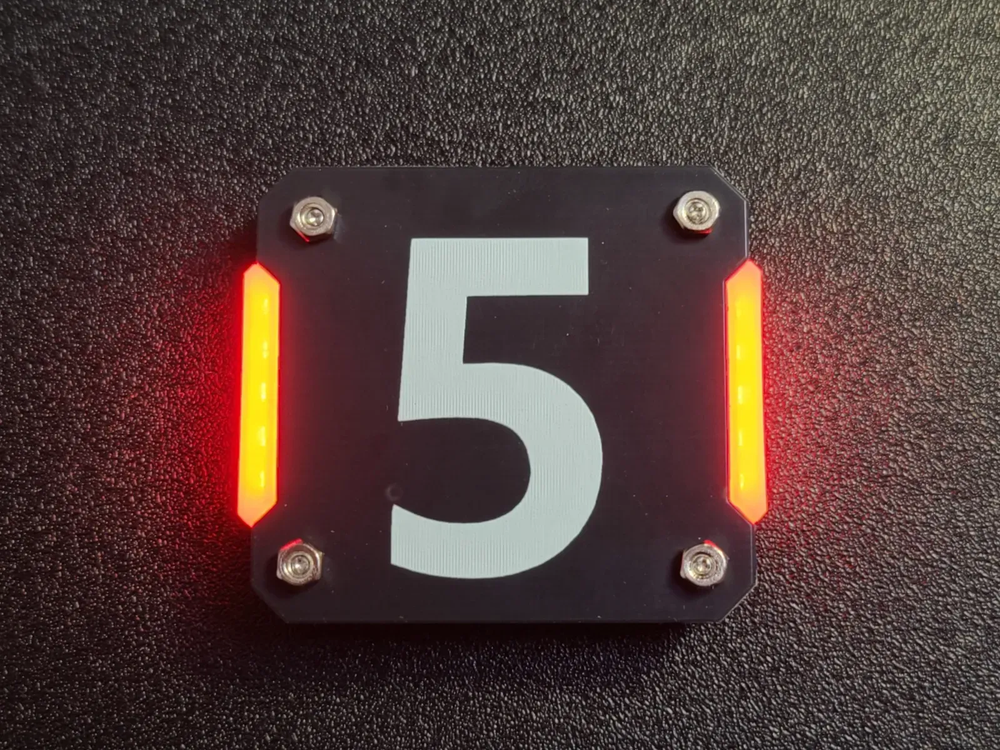
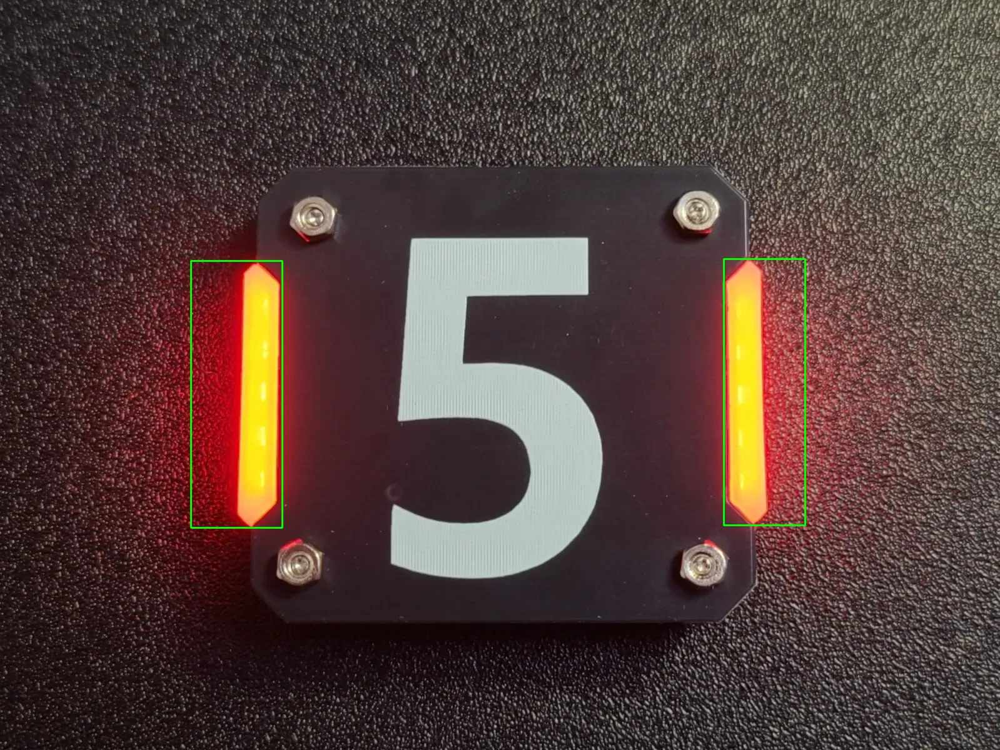

# RM_Learning

这是我在准备 RoboMaster 2027 视觉组考核时的学习代码仓库。

## 开发环境
- OS: Windows 11 + WSL2 (Ubuntu 22.04)
- Editor: VS Code (Remote - WSL)
- 依赖库: OpenCV 4.10.0 (C++)

## 文件说明
- `hello.cpp`: Linux 下的 C++ 编译测试。
- `peizhi.cpp`: OpenCV 版本读取及环境配置测试。
  
## 🚀 效果展示

### 原图 (armor.jpg)

### 红色灯条提取与框选结果

